# Promptfall

An idle fantasy RPG that runs inside Claude Code as a plugin, where a party of three heroes fights above the prompt while Claude works.

**Status: work in progress.** The solo game, the market, chat, leaderboards, the world boss and the self-hosted server are built and tested. The public server is offline at the moment, so today the game runs on the in-process server or on one you host. The public listing, hero skills, the challenge tower and PvP do not exist yet ([roadmap](docs/roadmap.md)).

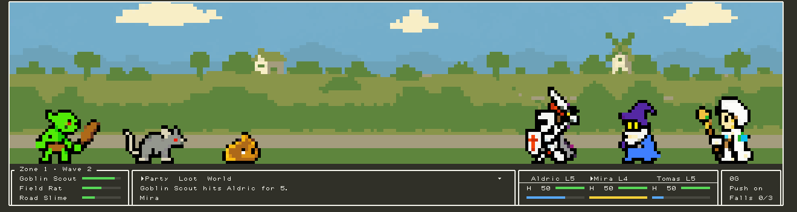

## What it is

Claude Code turns can run for minutes. Promptfall puts a battle in the band above the prompt for that time: each tool call Claude makes spawns an enemy, a turn with ten or more tool calls ends in a turn boss, and each prompt you submit is a short rest that heals the party. Progress needs a live interactive session. Headless runs (`claude -p`, subagents) never tick.

It is for people who already spend their day in Claude Code, and its first rule is that the game never gets in the way of the work. The band stays within the rows the engine gives it, drops to a compact band in narrow terminals, and switches off with one command. Gold is the only currency, and there is no real money anywhere.

Under the band, a pane holds the long game: a roster of heroes in four classes, 40 item bases with rarities and affixes, a market where players trade items and heroes, chat, leaderboards, a weekly hunt and a world boss every three hours that every online party fights together. One deterministic simulation, integer math only, runs on the client and on the server, so the server replays every batch and rolls every drop. Questions and ideas go to [GitHub Discussions](https://github.com/kevinshibuya/promptfall/discussions), and players talk on [Discord](https://discord.gg/U4R2G46Jhs).

## What works today

- **The fight follows Claude's work.** Tool calls spawn enemies, long turns end in turn bosses, prompts rest the party, and four reactive events shape the fight: Haste while a turn runs, Enrage on a failed tool call, Camp on compaction, Guard while a permission prompt waits. Evidence: `pnpm --filter @promptfall/sim test`, 457 tests.
- **Twelve zones, three tiers.** Each zone has four wave enemies, a boss after the tenth wave and a turn boss; the ladder runs the twelve zones again at tiers 2 and 3, to zone 36. Evidence: [the content reference](.claude/skills/promptfall-content/reference/content.md), generated by `pnpm content`.
- **Trading.** Items and heroes list on a shared market, buy orders fill the moment a matching listing is made, and every sale is a server event both parties' hashes cover. Evidence: `pnpm --filter @promptfall/ledger test`, 231 tests, and a contract suite that runs over the in-process ledger and over HTTP.
- **The world.** A world boss every three hours, a chat channel with a word list and a rate limit, leaderboards for highest zone and weekly boss damage, and bots that play through the public HTTP API like a player. Evidence: [docs/features.md](docs/features.md), `pnpm --filter @promptfall/fake-server test`, 233 tests.
- **Three renderers, one scene.** A pixel image in Ghostty and kitty, half-block text cells in other terminals, and an SVG with SMIL on the desktop app. Evidence: 83 golden scenarios in [plugins/promptfall/hooks/stage/goldens](plugins/promptfall/hooks/stage/goldens), checked by hash, and `pnpm smoke:desktop`, which loads each desktop SVG in headless Chromium.
- **Saves survive balance changes.** The sim is at version 19, and each bump ships a migration with golden fixtures. Evidence: `packages/sim/src/migrate.test.ts`.
- **Run your own server.** The host is one Node program on SQLite, shipped as a Docker image behind Caddy. Evidence: `deploy/smoke.sh <url>` (health, a bootstrap, one batch, one world poll).
- **Sound.** Eight 8-bit cues, written by `scripts/cues.ts`. Evidence: `pnpm cues:check` rebuilds them byte for byte.

### Next

1. The public listing: the server opens to everyone, and the plugin goes to the official Claude Code plugin marketplace.
2. Hero skills and techniques, picked by each hero's tactics.
3. The challenge tower: a daily seed everyone shares, climbed until the party wipes.
4. Async PvP and a rating that moves on server-verified results only.
5. More zones, classes, items and affixes.

## Look

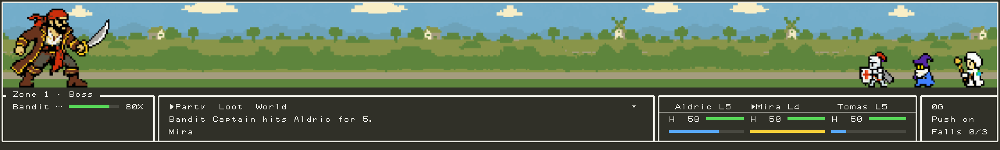
*A zone boss under a tall prompt. The band has 12 rows, so the whole stage shrinks to fit instead of cropping.*

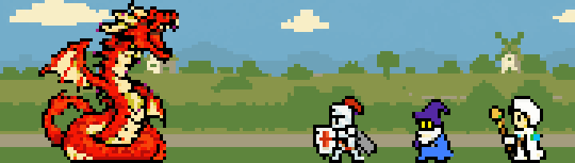
*The Promptwyrm, one of four world bosses, stepping out to strike. Every online party fights it at once.*

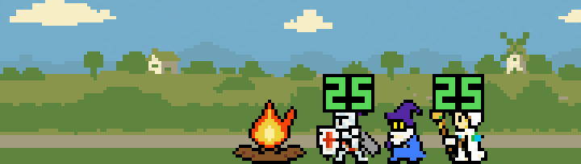
*When Claude compacts its context, the party camps at a fire and heals.*

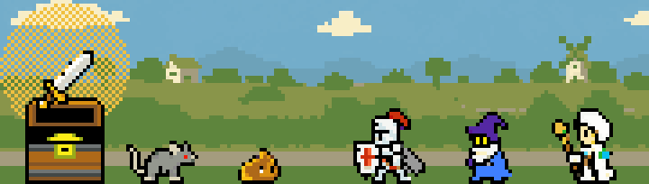
*On a legendary drop the chest opens and the item rises in its rarity's glow.*

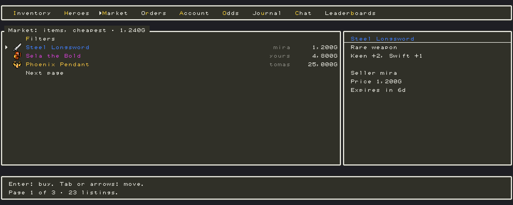
*The Market tab. The pane draws every tab as windows in a baked-in pixel font, with a cursor that follows the keyboard.*

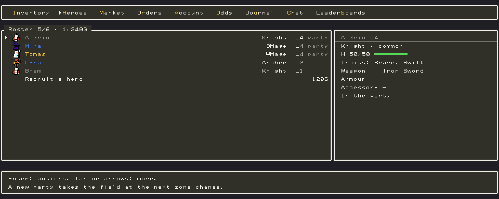
*The Heroes tab shows the roster in rarity colours and the selected hero's stats and gear.*

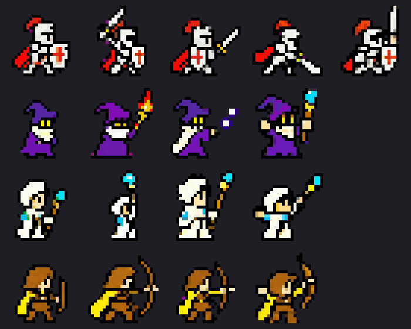
*The four classes and their drawn poses: idle, wind-up, strike, the knight's follow-through, victory.*

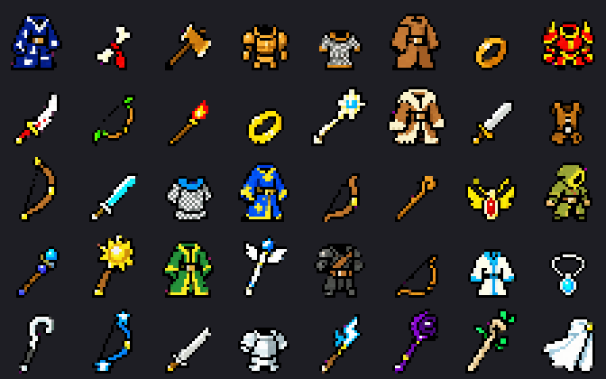
*The 40 item bases.*

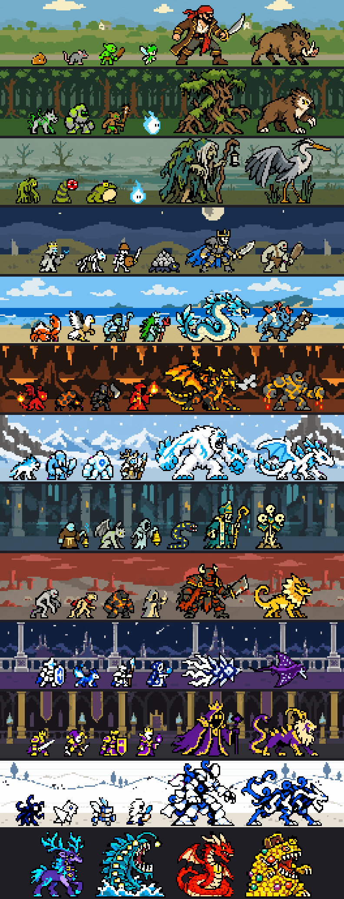
*All 72 enemies, one row per zone on that zone's backdrop: four wave enemies, the zone boss, the turn boss. The last row is the four world bosses.*

**How the art is made.** The sprite sheets are AI-generated from the prompts recorded in [art/sheets.md](art/sheets.md), cut into sprites with `pnpm slice`, which finds each sprite by the magenta gutters around it, and snapped to fixed palettes by `pnpm sprites`. The hero sprites carry hand fixes made with `pnpm grid`, which prints a sprite as text and writes it back. [scripts/cues.ts](scripts/cues.ts) synthesizes the eight sound cues with integer math, so the bytes match on every machine. The stated inspirations are early Final Fantasy for the sprites and Dragon Quest V for the windows; the spec excludes Final Fantasy's own sprites and signature designs, and no asset from either game ships. The pictures on this page come from `pnpm readme:images` ([scripts/readme-images.ts](scripts/readme-images.ts)), which renders them with the game's own stage code and upscales by whole numbers with nearest-neighbour sampling.

## Run it

| | |
| --- | --- |
| Runtime | Node.js 22 or later (`engines` in `package.json`); run here on 22.18.0 |
| Package manager | pnpm 11.5.2 (`packageManager` in `package.json`) |
| Operating system | Run here on macOS; CI runs on Linux. Playing needs Claude Code in a terminal or the desktop app |
| External services | None for development. Playing online uses the public server; the GitHub link uses GitHub's device flow |
| Paid keys | No |
| Ports | 7777 for the local server |
| Time to first run | About a minute: `pnpm install` took 22 s here |

### Play it

In a Claude Code session:

```
/plugin marketplace add kevinshibuya/promptfall
/plugin install promptfall@promptfall
```

The public server is offline at the moment, so switch to the in-process one:

```
/promptfall server local
```

Expect: a band above the prompt with the party on the stage, playing offline with no chat and no world boss. Not run here: these are interactive Claude Code commands.

### Develop

1. Clone the repository.

```
git clone https://github.com/kevinshibuya/promptfall.git && cd promptfall
```

Expect: a `promptfall` folder with `packages/`, `plugins/` and `servers/`.

2. Install the dependencies.

```
pnpm install
```

Expect: `Done in` followed by the time, `using pnpm v11.5.2`.

3. Lint and type-check.

```
pnpm lint && pnpm typecheck
```

Expect: a `Checked` line ending `No fixes applied.`, then `tsc` exits with no output.

4. Start the local server with 12 bots, at ten times speed.

```
pnpm fake --port 7777 --speed 10
```

Expect: `promptfall fake on http://127.0.0.1:7777 seed 1 speed 10 data`, followed by the path of its JSON store.

5. In a second terminal, run the server smoke against it.

```
deploy/smoke.sh http://127.0.0.1:7777
```

Expect: four lines, from `smoke: health ok, sim 19` to `smoke: world ok, 1 online`.

6. Load the plugin from the checkout and point it at the local server.

```
claude --plugin-dir plugins/promptfall
```

Expect: the band above the prompt. Then type `/promptfall server http://127.0.0.1:7777` in the session. Not run here: an interactive session.

### Check it works

```
pnpm test
```

Expect: one vitest summary per package, each ending `passed`: 457 tests in the sim, 66 in the protocol, 231 in the ledger, 233 in the server and 138 in the scripts. The plugin's own checks need a local Claude Code:

```
claude plugin validate plugins/promptfall
```

Expect: `Validation passed with warnings`.

### Environment variables

| Name | Required | What it does | How to get a value |
| --- | --- | --- | --- |
| `PROMPTFALL_SANDBOX` | Optional | Set to `1` when starting Claude Code: the session plays a sandbox save on the in-process server, with verbs that grant bosses, items and gold | Set it yourself |
| `PROMPTFALL_GITHUB_CLIENT_ID` | Optional | The server's GitHub OAuth app, for `--link github`. Without it the server starts and refuses every link | A GitHub OAuth app with device flow enabled; no client secret is needed |
| `PROMPTFALL_ADMIN_TOKEN` | Optional | Bearer token for the admin routes (flags, bans). Empty means no admin routes | `openssl rand -hex 32` |
| `PROMPTFALL_DEBUG` | Optional | Any value prints the bots' log lines | Set it yourself |

### If it fails

- **`pnpm typecheck:plugin` cannot find the engine's types.** They are generated per Claude Code version. Run `claude --plugin-dir plugins/promptfall` once interactively; it writes them under `.claude-plugin/types/`.
- **`pnpm smoke:desktop` has no browser.** Install Playwright's Chromium once: `pnpm exec playwright install chromium`.
- **CI fails `pnpm vendor:check` after a change in `packages/`.** The plugin carries bundled copies of the packages. Run `pnpm vendor` and commit the result.

For agents, the working rules live in [CLAUDE.md](CLAUDE.md), the project's terms in [GLOSSARY.md](GLOSSARY.md) and the project skills in `.claude/skills/`.

## How it's built

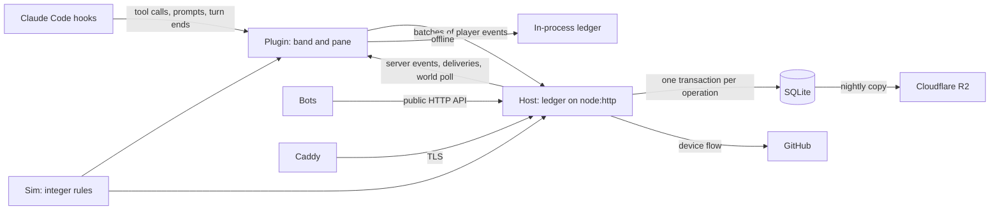

| Path | What lives there |
| --- | --- |
| `packages/sim` | The game rules and content: integer math, a seeded PRNG, migrations between sim versions |
| `packages/protocol` | Zod schemas for batches, server events and the market, the HTTP client, the server contract suite |
| `packages/ledger` | Accounts, batch replay, server events and deliveries, market rules |
| `servers/fake` | The host: the ledger behind `node:http` on SQLite or JSON, bots, flags, the GitHub link, backups |
| `plugins/promptfall` | The Claude Code plugin: stage, windows, pane, sounds, with the packages bundled into `hooks/vendor/` |
| `art` | Sprites at two densities, frames, zone backdrops, palettes, the font source, `sheets.md` |
| `scripts` | Generators and checks: sprites, font, cues, goldens, sheet slicing, these README images |
| `deploy` | The compose project, Caddy site block, deploy, rollback, backup and smoke scripts, the runbook |
| `docs` | The [spec](docs/spec/promptfall.md), [ADRs](docs/adr), [features](docs/features.md), plans, manual-pass scripts, [privacy](docs/privacy.md) |
| `.claude/skills` | Project skills: content names and sandbox verbs |

## Why it's built this way

**The interface is drawn as pictures of windows, with the pixel font baked in.** Next to the pixel sprites, the band's terminal text read as raw. Terminal text inside graphic frames lost because it mixes smooth type with pixel frames. The cost is text you cannot select, which ignores the terminal's font size. The font moved from DotGothic16 to Misaki Gothic 2nd after a measurement against Dragon Quest V. DotGothic16's 13 px capitals fill a 16 px row, where DQ V sets 7 px capitals. [ADR 0005](docs/adr/0005-interface-drawn-as-windows.md)

**Every surface draws the same stage at the pixels it has.** The first design gave half-block terminals their own 1x art, and a manual pass read the result as the game being "way more zoomed in with different hero art" there. The 1x stage art is gone. Half-block terminals now render the 1.5x scene and scale it down, showing about two-thirds of the pixels. A taller, wider band for 1:1 pixels lost because the band never changes height. [ADR 0018](docs/adr/0018-one-stage-density-on-every-surface.md), superseding [ADR 0006](docs/adr/0006-two-art-densities.md) for the stage

**The real server is the HTTP fake's host, on SQLite.** The spec planned NestJS over Postgres and Redis with a worker, which meant weeks of work and three daemons. The launch box is a shared free tier (2 vCPU, 12 GB), and the expected load fits one process. By the ADR's numbers, 2,000 players poll at 133 requests a second at rest and 400 during a world boss. One SQLite table replaced the JSON file store, which rewrote the whole snapshot on every operation. Postgres and Redis come back when a measured number asks for them. [ADR 0012](docs/adr/0012-the-real-server-is-the-ledger-host-on-sqlite.md)

**Saves migrate by snapshot transform.** Players keep a party for months, and the core loop work changed the combat formula, the XP curve, hero stats and affix values; a reset per sim version bump would have thrown every party away four times in a row. Replaying an account's history under new rules lost because it changes the past, so an Epic drop could turn Common. The first draft migrated both stored snapshots, and a check against the plugin's boot showed the client and server would disagree whenever a delivery was pending. [ADR 0013](docs/adr/0013-saves-migrate-by-snapshot-transform.md)

**Reactive events shape the fight and never change rewards.** The server cannot see Claude's tools, failures or compactions; it sees a batch a client claims. An event that paid would be the first thing a script could farm, and rate caps bound the gain without removing the reason to fake. A subagent summon failed this test and stays out. [ADR 0014](docs/adr/0014-reactive-events-never-change-rewards.md)

**A listing fills a matching buy order the moment it is made.** The spec said no auto-match. A manual pass listed an item under an open order, expected the sale and got nothing, and a seller who undercuts an order with no sale reads the market as broken. The fill pays the order's maximum. [ADR 0015](docs/adr/0015-buy-orders-fill-at-listing-time.md)

**The balance suite runs once per batch, not in every gate.** Nine seeds over 120 live hours cost about 100 of the sim package's 112 seconds in every ticket's gate, and a red arc pushed balance decisions into tickets about something else. `pnpm test` excludes it; `pnpm test:arc` runs it once at the end of a batch, and retuning is the owner's call on the table. [ADR 0017](docs/adr/0017-arcs-run-once-per-batch.md)

## How it was made

Each feature starts as a grilling session that becomes a spec in [docs/spec](docs/spec/promptfall.md) and decisions in [docs/adr](docs/adr). Agents in Claude Code build the tickets cut from the spec, and a ticket lands only when its verify gate passes. The owner reviews each batch by hand, with the scripted passes in [docs/manual-pass](docs/manual-pass), before it merges. The working rules are in [CLAUDE.md](CLAUDE.md).

## Credits and licence

MIT, `Copyright (c) 2026 Kevin Shibuya`: see [LICENSE](LICENSE). The art, the sound cues and the code are the project's own and ship under that licence. The plugin also ships third-party work under its own licences, listed in full in [plugins/promptfall/NOTICE.md](plugins/promptfall/NOTICE.md):

- claude-toons by Anshu Chimala, MIT: three stage techniques (half-block cell packing, the Bayer fade, the blit loop's shape). None of its art is used.
- Misaki Gothic 2nd by Num Kadoma, under its author's free licence (use, copy and distribute without limit): the window font's glyph bitmaps. The plugin ships the bitmaps, not the font file.
- [fflate](https://github.com/101arrowz/fflate) 0.8.2 by Arjun Barrett, MIT: the deflate inside the stage's PNG frames.

Promptfall is an independent project. It is not affiliated with Anthropic, or with Square Enix, which owns Dragon Quest and Final Fantasy.

[docs/privacy.md](docs/privacy.md) lists what the public server stores and how to delete your account.
